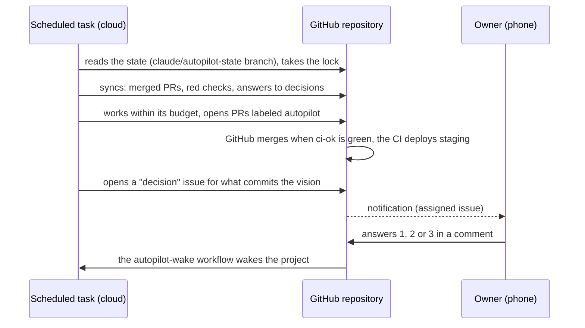

# App factory and autopilot

## App factory: a project from idea to production

`app-factory` turns the main session into a conductor. It splits the work, hands it to specialized
subagents, keeps the project state on disk and has every step verified.

**Three modes**: creation from an idea; clone, which reproduces the value of a reference app without
copying its brand, its texts or its code; takeover of an existing or unfinished app (inventory, reverse
specification, audit, plan).

**Eight phases and their gates**:

| Phase | Purpose | Gate |
|---|---|---|
| P0 Scoping | mode, brief, inventory | G0 brief approved |
| P1 Discovery | problem, targets, competition, business model | G1 go, pivot or stop |
| P2 Specification | PRD, requirements, legal obligations, cost envelope | G2 PRD frozen |
| P3 Design | architecture, data, UX, threat model, costs | G3 design approved |
| P4 Planning | milestones, backlog, acceptance criteria | G4 backlog ready |
| P5 Build | skeleton with CI (M0), then each story implemented, reviewed, tested | G5 per milestone |
| P6 Pre-production | CD, monitoring, backups, final audits | G6 go or no-go |
| P7 Launch | production release, launch, measurement, iteration | G7 post-launch review |

**18 agents**: product, strategy, project manager, architect, data, design, security, compliance,
finops, implementation, review, QA, release, SRE, growth, code inventory, reverse specification, and an
independent gate verifier that reruns build, type checking, lint, tests, dependency audit and secret
scanning itself.

**Principles**: one bounded task per agent; parallelism only on disjoint files; an agent's report is a
claim, not a fact, and the orchestrator verifies it; at most two attempts on the same failure before
escalating; the state (`.app-factory/state.json`) is authoritative after an interruption.

**Always confirmed by the human**, whatever the level: payment, account creation, contract, store
submission, publication, advertising spend, production release, migration on real data, deletion of
resources.

## Autopilot: a project that moves forward without waiting

The problem addressed: agents that wait for work to be handed out, then return a long report to read and
arbitrate. In autopilot, the project moves forward through **scheduled wake-ups** and the human only
settles what requires their vision.

**Decision policy**:

- **A, decided alone and logged**: internal technical choices, story order, fixes, gates passed with a
  favorable verdict from the verifier.
- **B, decided alone and flagged** in the dashboard: non-structural deviation from an architecture
  decision, significant new dependency.
- **C, decision card** to the owner: vision, scope, pricing, brand, choices hard to undo, legal,
  production release, publication, repeated failure. The project continues on everything that does not
  depend on it.
- **D, excluded**: credentials taken from outside the project, secrets in the code, bypassing guardrails.

**Autopilot-specific guardrails**:

- the agent never merges: GitHub merges when the required check `ci-ok` is green;
- a PR that touches `.github/`, `.claude/` or the production infrastructure is refused for automatic
  merge;
- production goes through a GitHub environment where the owner is a required reviewer;
- the budget is counted in agents per wake-up and per day; a wake-up with no work costs almost nothing;
- everything the autopilot writes carries a marker that prevents it from mistaking it for an answer from
  the owner.

**Setup** (once per project, by the owner): the `autopilot` skill, reference `setup.md`, scripts
`export_to_repo.py` (the cloud does not install plugins: the skills, agents and hooks are copied into the
repository's `.claude/`) and `init_autopilot.py` (labels, dashboard, state branch, workflows; changes
nothing without `--apply`).
