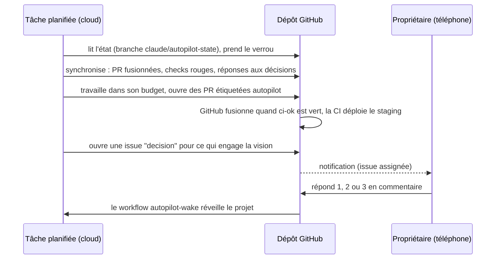

# App factory et autopilot

## App factory : un projet de l'idée à la production

`app-factory` fait de la session principale un chef d'orchestre. Il découpe le travail, le confie à des
sous-agents spécialisés, tient l'état du projet sur disque et fait vérifier chaque étape.

**Trois modes** : création depuis une idée ; clone qui reproduit la valeur d'une app de référence sans
copier sa marque, ses textes ni son code ; reprise d'une app existante ou inachevée (inventaire,
rétro-spécification, audit, plan).

**Huit phases et leurs portes** :

| Phase | Objet | Porte |
|---|---|---|
| P0 Cadrage | mode, brief, inventaire | G0 brief validé |
| P1 Découverte | problème, cibles, concurrence, modèle économique | G1 go, pivot ou stop |
| P2 Spécification | PRD, exigences, obligations légales, enveloppe de coût | G2 PRD gelé |
| P3 Conception | architecture, données, UX, modèle de menace, coûts | G3 conception validée |
| P4 Planification | jalons, backlog, critères d'acceptation | G4 backlog prêt |
| P5 Construction | squelette avec CI (M0), puis chaque story implémentée, relue, testée | G5 par jalon |
| P6 Pré-production | CD, monitoring, sauvegardes, audits finaux | G6 go ou no-go |
| P7 Lancement | mise en production, lancement, mesure, itération | G7 revue post-lancement |

**18 agents** : produit, stratégie, chef de projet, architecte, données, design, sécurité, conformité,
finops, implémentation, revue, QA, release, SRE, growth, inventaire de code, rétro-spécification, et un
vérificateur de portes indépendant qui rejoue lui-même build, typage, lint, tests, audit des dépendances
et recherche de secrets.

**Principes** : une tâche bornée par agent ; parallélisme seulement sur des fichiers disjoints ; un
compte rendu d'agent est une affirmation, pas un fait, et l'orchestrateur vérifie ; deux essais au plus
sur un même échec avant d'escalader ; l'état (`.app-factory/state.json`) fait foi après une interruption.

**Toujours confirmé par l'humain**, quel que soit le niveau : paiement, création de compte, contrat,
soumission en store, publication, dépense publicitaire, mise en production, migration sur données
réelles, suppression de ressources.

## Autopilot : un projet qui avance sans attendre

Le problème visé : des agents qui attendent qu'on leur distribue le travail, puis rendent un long rapport à
lire et à arbitrer. En autopilot, le projet avance par **réveils planifiés** et l'humain ne tranche que ce
qui demande sa vision.

**Politique de décision** :

- **A, décidé seul et tracé** : choix techniques internes, ordre des stories, corrections, portes
  franchies avec un verdict favorable du vérificateur.
- **B, décidé seul et signalé** dans le tableau de bord : écart non structurant à une décision
  d'architecture, nouvelle dépendance importante.
- **C, carte de décision** au propriétaire : vision, périmètre, prix, marque, choix difficiles à défaire,
  droit, mise en production, publication, échec répété. Le projet continue sur tout ce qui n'en dépend
  pas.
- **D, exclu** : identifiants pris hors du projet, secrets dans le code, contournement de garde-fous.

**Garde-fous propres à l'autopilot** :

- l'agent ne fusionne jamais : GitHub fusionne quand le check requis `ci-ok` est vert ;
- une PR qui touche `.github/`, `.claude/` ou l'infrastructure de production est refusée à la fusion
  automatique ;
- la production passe par un environnement GitHub dont le propriétaire est relecteur obligatoire ;
- le budget se compte en agents par réveil et par jour ; un réveil sans travail ne coûte presque rien ;
- tout ce que l'autopilot écrit porte un marqueur qui l'empêche de se prendre pour une réponse du
  propriétaire.

**Mise en place** (une fois par projet, par le propriétaire) : la skill `autopilot`, référence
`setup.md`, scripts `export_to_repo.py` (le cloud n'installe pas les plugins : les skills, les agents et
les hooks sont copiés dans le `.claude/` du dépôt) et `init_autopilot.py` (labels, tableau de bord,
branche d'état, workflows ; ne change rien sans `--apply`).
