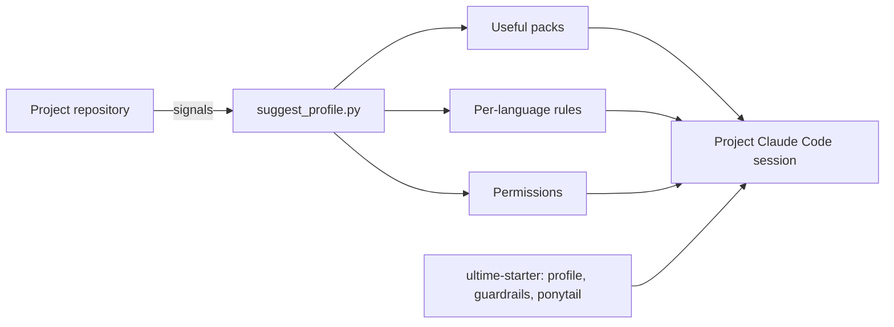
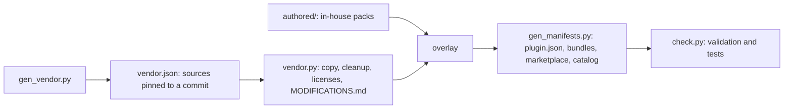

# Architecture

## The Claude Code building blocks used

| Building block | Role | Context cost |
|---|---|---|
| Skill (`SKILL.md`) | a piece of know-how loaded on demand; only its description is always present | the description, in every session |
| Agent (`agents/*.md`) | a specialized subagent with its own context, tools and model | its description |
| Hook | a script run by Claude Code on an event (before a tool, at startup); it can refuse an action | none, except the text it injects |
| Rule (`.claude/rules/*.md`) | a project instruction; with `paths:`, loaded only when Claude touches a matching file | none outside those files |
| Plugin | an installable package that groups skills, agents and hooks | the sum of its contents |

## Other coding agents

The Claude Code plugins are the single source. The build also writes a Cursor marketplace
(`.cursor-plugin/`), and the universal installer (`bin/ultime-skill.cjs`) copies and converts, at install
time, what each other agent reads: skills into the shared `.agents/skills` folder of the Agent Skills
standard, subagents into each agent's format (TOML for Codex, Markdown elsewhere), commands, the
guardrails hook in the agent's protocol, and the always-on rules in its instructions file. Nothing is
copied into the repository for them. Details: [Coding agents](harnesses.md).

## Packs, bundles, profiles

- **Pack**: a coherent plugin (`security`, `mobile-expo`, `ci-forge`...). 43 packs, each installable on
  its own.
- **Bundle**: an empty plugin that depends on several packs (`ultime-starter`, `ultime-dev`,
  `ultime-factory`, `ultime-all`...). Convenient, but a large bundle active everywhere is expensive in
  context.
- **Profile**: a project's selection of packs, computed by `ultime-profile` from repository signals
  (`references/stack-map.json`: a `package.json` with `next`, a `pyproject.toml` with `fastapi`, a
  `Dockerfile`, some `*.tf`...) and installed at project level.

## Context economy

Every active skill description is sent on every turn. The full catalog represents about 182,000
characters of them (on the order of 45,000 tokens), far beyond what Claude Code keeps for this purpose:
it then drops part of them and chooses less well. Hence three mechanisms:

1. **Per-project activation**: a web application or API profile weighs 13 to 15% of the catalog.
2. **File-scoped rules**: per-language conventions cost nothing as long as Claude does not touch a
   matching file (verified in a real session).
3. **Controlled descriptions**: `check.py` flags an in-house description longer than 400 characters or a
   `SKILL.md` longer than 500 lines; the detail goes into references read on demand.

The `app-factory` agents each have a model suited to their role (a light model for the inventory, an
intermediate model for implementation and review, the session's model for architecture, security and
gate verification), which reduces the cost of repetitive tasks.

## Reproducible build

Nothing in `plugins/` is edited by hand: everything is regenerated.

- `scripts/gen_vendor.py` describes each source (repository, commit, license) and each import; it writes
  `vendor.json`.
- `scripts/vendor.py` fetches each pinned commit, copies the files, replaces em dashes, removes invisible
  Unicode characters and flagged self-promotion, copies the license and the original notice, and writes
  `MODIFICATIONS.md` wherever a file changed. It never executes anything coming from an upstream
  repository.
- `authored/` contains the in-house packs, overlaid on `plugins/`.
- `scripts/gen_manifests.py` writes the manifests, the bundles, the marketplace and the cost catalog.
- `scripts/check.py` validates the skills and agents, refuses em dashes and invisible Unicode, flags risky
  patterns, and runs the tests (`tests/`).
- `scripts/build.py` chains it all.

## What is written in-house

| Pack | Contents |
|---|---|
| `app-factory` | orchestrator, clone and takeover modes, autopilot, 18 agents |
| `guardrails` | hook engine and its rules, also installable in a project |
| `ci-forge` | stack detection, action pinning, per-stack references |
| `ultime-profile` | project profiles, per-language rules, permissions |
| `security` (in part) | `security-review`, `sast` |
| `ui-design` (in part) | `ui-review` |
| `mobile`, `app-stores`, `growth` (in part), `compliance` (in part), `monitoring`, `prod-testing`, `finops` (in part), `team-conventions` | know-how missing or insufficient in public sources |
