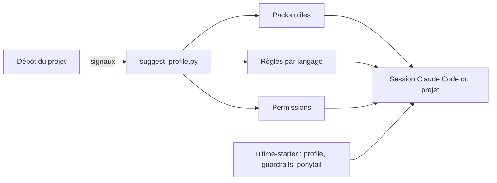
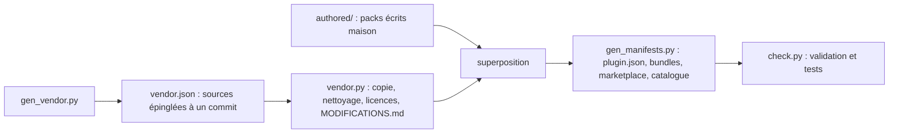

# Architecture

## Les briques de Claude Code utilisées

| Brique | Rôle | Coût en contexte |
|---|---|---|
| Skill (`SKILL.md`) | un savoir-faire chargé à la demande ; seule sa description est présente en permanence | la description, à chaque session |
| Agent (`agents/*.md`) | un sous-agent spécialisé avec son propre contexte, ses outils et son modèle | sa description |
| Hook | un script lancé par Claude Code sur un événement (avant un outil, au démarrage) ; il peut refuser une action | nul, sauf le texte qu'il injecte |
| Règle (`.claude/rules/*.md`) | une consigne de projet ; avec `paths:`, chargée seulement quand Claude touche un fichier concerné | nul hors de ces fichiers |
| Plugin | un paquet installable qui regroupe skills, agents et hooks | la somme de son contenu |

## Packs, bundles, profils

- **Pack** : un plugin cohérent (`security`, `mobile-expo`, `ci-forge`...). 43 packs, chacun installable
  seul.
- **Bundle** : un plugin vide qui dépend de plusieurs packs (`ultime-starter`, `ultime-dev`,
  `ultime-factory`, `ultime-all`...). Pratique, mais un bundle large actif partout coûte cher en contexte.
- **Profil** : la sélection de packs d'un projet, calculée par `ultime-profile` à partir de signaux du
  dépôt (`references/stack-map.json` : un `package.json` avec `next`, un `pyproject.toml` avec `fastapi`,
  un `Dockerfile`, des `*.tf`...) et installée au niveau du projet.

## Économie de contexte

Chaque description de skill active est envoyée à chaque tour. Le catalogue complet en représente environ
182 000 caractères (de l'ordre de 45 000 tokens), bien au-delà de ce que Claude Code garde pour cet
usage : il en écarte alors une partie et choisit moins bien. D'où trois mécanismes :

1. **Activation par projet** : un profil d'application web ou d'API pèse 13 à 15 % du catalogue.
2. **Règles à portée de fichier** : les conventions par langage ne coûtent rien tant que Claude ne touche
   pas un fichier concerné (vérifié en session réelle).
3. **Descriptions maîtrisées** : `check.py` signale une description écrite maison de plus de 400
   caractères ou un `SKILL.md` de plus de 500 lignes ; le détail va dans des références lues à la demande.

Les agents d'`app-factory` ont chacun un modèle adapté à leur rôle (un modèle léger pour l'inventaire, un
modèle intermédiaire pour l'implémentation et la revue, celui de la session pour l'architecture, la
sécurité et la vérification des portes), ce qui réduit le coût des tâches répétitives.

## Construction reproductible

Rien dans `plugins/` n'est édité à la main : tout est régénéré.

- `scripts/gen_vendor.py` décrit chaque source (dépôt, commit, licence) et chaque import ; il écrit
  `vendor.json`.
- `scripts/vendor.py` récupère chaque commit épinglé, copie les fichiers, remplace les em dash, retire les
  caractères Unicode invisibles et l'autopromotion signalée, copie la licence et la notice d'origine, et
  écrit `MODIFICATIONS.md` là où un fichier a changé. Il n'exécute jamais rien venant d'un dépôt amont.
- `authored/` contient les packs écrits maison, superposés sur `plugins/`.
- `scripts/gen_manifests.py` écrit les manifestes, les bundles, la place de marché et le catalogue des
  coûts.
- `scripts/check.py` valide les skills et les agents, refuse les em dash et l'Unicode invisible, signale
  les motifs à risque, et lance les tests (`tests/`).
- `scripts/build.py` enchaîne le tout.

## Ce qui est écrit maison

| Pack | Contenu |
|---|---|
| `app-factory` | orchestrateur, modes clone et reprise, autopilot, 18 agents |
| `guardrails` | moteur de hooks et ses règles, installable aussi dans un projet |
| `ci-forge` | détection de stack, épinglage des actions, références par stack |
| `ultime-profile` | profils de projet, règles par langage, permissions |
| `security` (en partie) | `security-review`, `sast` |
| `ui-design` (en partie) | `ui-review` |
| `mobile`, `app-stores`, `growth` (en partie), `compliance` (en partie), `monitoring`, `prod-testing`, `finops` (en partie), `team-conventions` | savoir-faire absents ou insuffisants dans les sources publiques |
